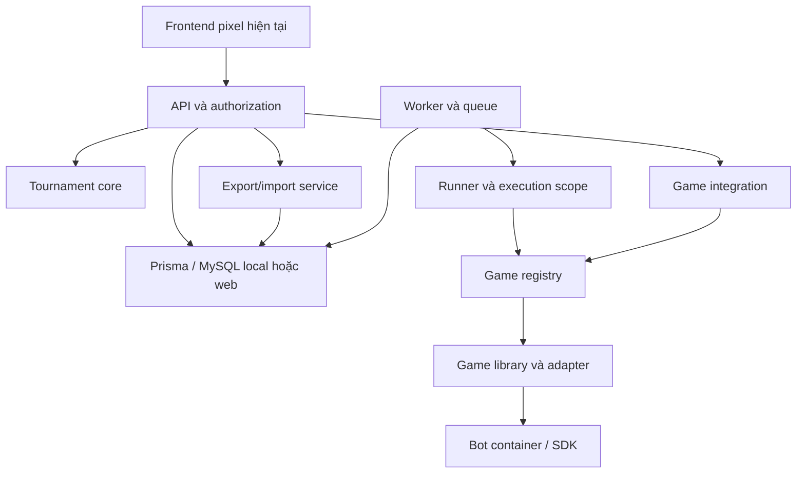

# OTTv2: audit, refactor và vận hành giải bot

Nguồn: `OTTv2-main(10).zip` do người dùng cung cấp. GitHub connector xác nhận repo `AnotherMousey/OTTv2`, nhánh mặc định `main`; không dùng remote để ghi đè ZIP, không push hay deploy. Báo cáo này mô tả bản thay đổi đi kèm, không chứng nhận production.

## 1. Kiến trúc trước khi sửa

| Vị trí | Luồng thực tế và trách nhiệm đang trộn |
|---|---|
| `services/api/tournaments.cjs` | HTTP request, kiểm tra phase/owner, Prisma transaction, ghép cặp, tạo Match/Job, cấu hình map, màu đi trước và maxTurns trong cùng module. `advance` đọc Entry/Submission, gọi `pairEntries`, gọi `resolveConfig`, rồi ghi Match; phase pairing tạo Job. |
| `services/shared/domain.cjs` | Password, validation dữ liệu HTTP, bot upload, pairing và Elo chung một file. |
| `logic/games/registry.js` | Tên là registry nhưng chỉ nhận `ottv2`; import engine/config OTTv2 trực tiếp. `specification` chứa RPS, bàn grid, white/black. Không phải registry mở. |
| `logic/grader.js` | Biên dịch SDK Java/C++/Python, đọc stdout, requestMove; `runMatch` biết currentTurn, serializeBotState, movePiece, skipTurn, forfeit, capture và giới hạn lượt OTTv2. |
| `services/runner/index.cjs` | HTTP/auth/concurrency, tạo engine OTTv2, kiểm tra bot và chạy grader trong cùng handler. |
| `services/worker/index.cjs` | Lấy submission/user từ DB, tạo request runner, heartbeat, đọc NDJSON, gom frame và kết thúc job. Deadline suy ra trực tiếp từ maxTurns của game. |
| `services/worker/queue.cjs` | Claim/recover/frame/finish và cập nhật Elo cùng transaction; finish chuyển `winner:white/black` thành score. |
| `prisma/schema.prisma` | Tournament lưu mapId/firstSide/maxTurns; Match lưu white/black và JSON config. Chưa có identity library bất biến, receipt hay hợp đồng offline export/import. |
| `frontend/src/tournamentModel.js` | Logic pairing/Elo cho preview; không phải nguồn có thẩm quyền của giải dùng backend. Không đổi để tránh thay hành vi demo. |
| `frontend/src/api/platformApi.js`, `frontend/src/AccountPages.jsx`, `frontend/src/TournamentWorkspace.jsx`, `frontend/src/WatchLive.jsx` | UI gọi API; hiển thị giải và replay. Parser có adapter, nhưng UI hiện tại vẫn mang tên/renderer OTTv2. |
| `compose.local.yaml`, `Dockerfile` | Đã có MySQL/API/worker/runner local. Dockerfile trước sửa không đóng gói frontend; không có lệnh chuẩn bị image trước khi mất Internet. |

Luồng trận: upload bot → API tạo Submission + validation Job → worker claim → runner biên dịch/chạy container → queue ghi ready. Judge advance → frozen submissions + Match → Job → worker → runner/grader/engine → frame batches → queue.finish → Match + User rating trong transaction → frontend polling/replay.

Baseline: lần chạy chưa cài dependency có 10 pass, 2 module-loading failures (`@prisma/client`). Sau npm ci và prisma generate: 14 backend tests và 29 frontend tests pass. Không gọi lỗi thiếu dependency là lỗi nghiệp vụ.

## 2. Kiến trúc đích đã triển khai



- `services/platform/tournament.cjs`: pairing, Elo, kiểm tra score. Không import engine, loại quân, bàn cờ hay điều kiện thắng.
- `services/platform/game-integration.cjs`: chuyển settings cũ thành input library; freeze identity; kiểm tra identity khi chạy; chuẩn hóa kết quả/deadline. Đây là nơi được phép biết tên settings OTTv2.
- `logic/games/ottv2/plugin.cjs`: luật/cấu hình, SDK/grader, metadata/replay OTTv2. `logic/grader.js` giữ nguyên cho compatibility; game khác không bị buộc dùng vòng lặp đó.
- `services/runner/index.cjs`: gọi plugin.configure/validate/run; vẫn giữ HTTP và protocol NDJSON cũ.
- `services/runner/execution-scope.cjs`: hủy async task, dọn container và dọn compilation trả về muộn sau deadline.
- Queue nhận score của slot 0; storage/API vẫn đặt tên hai slot là white/black. Không đổi schema mọi participant slot trong đợt này.

### Interface game plugin

```js
{
  identity: { id, libraryVersion, rulesVersion, protocolVersion, rendererVersion },
  artifacts: [/* absolute paths of additional operator-owned dependencies */], // optional
  configure(input, mode),             // validate and normalize configuration
  deadlineMs(config),                 // finite execution deadline
  specification(),                    // SDK/renderer/config metadata
  score(result),                      // participant slot 0: 0, 0.5 or 1
  validate({bot, id, config, factory, stop, signal}),
  run({id, bots, config, factory, stop, signal, onFrame}) // replay + result
}
```

Initial state, legal moves, transition, end condition, capture và serialization nằm trong library. OTTv2 adapter dùng Engine đã có; nền tảng không ép mọi game có `board`, `movePiece` hay `winner:white`. Hợp đồng `run` là execution boundary, không phải universal turn protocol. Library mới tự cung cấp vòng lặp trạng thái phù hợp. Registry thêm `libraryDigest`: OTTv2 hash plugin/engine/config/utils/constants/grader/protocol/replay-log; plugin ngoài hash module và các `artifacts` khai báo. SDK/container image không nằm trong hash này; phải version và chuẩn bị riêng khi đổi SDK. Hash phát hiện khác byte, không chứng minh tác giả hay tính đúng đắn.

`Match.config._game` cố định identity. Job cũ không có `_game` vẫn chạy theo OTTv2 hiện hành để giữ compatibility; không thể truy hồi chính xác phiên bản của dữ liệu lịch sử không có identity. Match mới bị từ chối nếu library cài đặt khác phiên bản/hash. API, worker và runner phải mount cùng library.

`GAME_PLUGIN_MODULE` là đường dẫn module do giảng viên cài trong environment; không nhận path từ request/bot. Một module có thể đăng ký một game bổ sung cho mỗi process. Không thay library giữa một job đang chạy. Dừng nhận job, hoàn tất/dừng có kiểm soát rồi khởi động lại các process.

### Phần còn gắn OTTv2

- Tên white/black trong DB và API, hai người chơi, kết quả win/draw/loss với Elo.
- Settings mapId/firstSide/maxTurns của API cũ được chuyển trong integration.
- Java/C++/Python SDK và bot container đang đóng gói giao thức OTTv2.
- UI bàn cờ, Rules và renderer pixel hiện tại.
- `logic/main.js`/room compatibility API và grader cũ vẫn là OTTv2.

Game mới dùng cùng pairing, phases, queue, receipt và accounts khi vẫn là trận hai người có score 0/0.5/1. Cần SDK/runtime adapter và renderer nếu giao thức hoặc hình thức hiển thị khác. Game nhiều người, simultaneous play, điểm liên tục hoặc ranking khác Elo cần mở rộng hợp đồng; không tuyên bố chỉ thay một file cho mọi trò chơi.

Bằng chứng: `services/tests/game-plugin.test.cjs` chạy take-away không có board qua cùng pairing/Elo. Factory trong test là giả; `samples/plugins/take-away.cjs` là fixture tích hợp, chưa phải game production có SDK/container/renderer đầy đủ. Không thể bật fixture đó rồi kỳ vọng bot OTTv2 cũ chạy đúng.

## 3. Phân loại thay đổi

| Loại | Nội dung |
|---|---|
| Refactor giữ hành vi | Tách pairing/Elo; registry/plugin OTTv2; façade cấu hình; runner gọi plugin. Công thức Elo và thuật toán ghép cặp cũ không đổi. |
| Gia cố lỗi/hang | Runner intake timeout; async plugin timeout; cleanup bot khởi động muộn. Không sửa luật game. |
| Chức năng mới | Offline images/start; frontend cùng máy; export từng replay; mapping plan; begin/part/complete import có resume. |
| Schema/migration | `202610140002_game_sync`: Tournament.gameId/gameConfig, SyncReceipt, SyncPart. Chỉ thêm cột/bảng; chưa chạy trên dữ liệu thật. |

Không đổi frontend source/public, font, CSS, artwork, animation. Build cùng mã hiện tại. Chưa thực hiện so sánh screenshot light/dark hoặc kiểm thử trình duyệt/LAN; không chứng nhận pixel equality bằng screenshot.

## 4. Online và offline dùng chung nghiệp vụ

Online giữ các lệnh `npm start`, `npm run worker`, `npm run runner`; migrate bản mới trên DB staging trước. Nếu dùng Dockerfile API mới, frontend cũng được build và phục vụ tại `/app/`; root `/` vẫn trả JSON cũ. Vercel tách frontend vẫn dùng được; không sửa env API cũ.

Chuẩn bị trước buổi thi, khi còn Internet:

```bash
cp .env.example .env
# Set MYSQL_PASSWORD, MYSQL_ROOT_PASSWORD, OPERATOR_PASSWORD (>=12 chars)
# and RUNNER_SECRET (>=32 chars); use URL-safe DB password characters.
npm run offline:prepare
npm run offline
```

`offline:prepare` tải MySQL và build bot/API/runner images. `offline` chỉ kiểm tra images rồi compose up với `--no-build --pull never`; runtime không chạy npm install, image pull, CDN hay remote DB. Images có sẵn là điều kiện bắt buộc. Nếu máy thi không có Node 24, chạy trực tiếp:

```bash
docker compose --env-file .env -f compose.offline.yaml up -d --no-build --pull never
```

Frontend: `http://127.0.0.1:3000/app/`. API: `http://127.0.0.1:3000`. Local DB riêng trong volume `offline-mysql`. Worker/runner dùng cùng code online. Bootstrap local chỉ tạo judge khi chưa tồn tại, không reset mật khẩu.

LAN: đặt `OFFLINE_BIND=0.0.0.0`; đặt `OFFLINE_ORIGINS=http://IP_MAY_CHU:3000`; mở port 3000 trong firewall của máy chủ. Không mở MySQL ra LAN. Bot containers có `--network=none`, CPU 1, RAM 512 MiB, pids 128 và tmpfs 256 MiB như code hiện tại. Runner dùng Docker socket nên cần máy tổ chức đáng tin cậy; chưa đo overhead/cách ly thực tế ở đây.

### Quy trình 5 giờ

1. Trước buổi: thử cold-start khi ngắt mạng; lưu images và backup volume; test Java/C++/Python trên đúng máy thi. Không bắt đầu tải dependency lúc đề đã được công bố.
2. Công bố đề: đặt library trong `local-games/`, mount vào API/worker/runner; env `GAME_PLUGIN_MODULE=/app/local-games/new-game.cjs`. Library/SDK/renderer hoàn toàn mới vẫn cần viết và thử; kiến trúc không bảo đảm công việc đó xong trong vài phút.
3. Nếu chỉ đổi OTTv2 map/luật được cấu hình: đặt maps JSON trong `local-games/maps/`, đặt `GAME_MAP_DIR=/app/local-games/maps`, có đủ mọi map sẽ dùng; restart stack. Có thể giữ game library và dùng settings API để chọn map/giới hạn. Không đổi config của trận đã freeze.
4. Nhập accounts: đặt `players.json` trong `offline-input/`; gồm `username`, `name`, `password`. Chạy:

```bash
docker compose --env-file .env -f compose.offline.yaml exec api npm run db:accounts -- /app/offline-input/players.json
```

5. Giảng viên tạo giải, sinh viên đăng nhập/join; judge duyệt, chuyển preparation; sinh viên nộp bot và chạy practice. Judge chỉ ghép khi mọi bot ready.
6. Vận hành các phase hiện có: registration → preparation → pairing → live → preparation vòng tiếp → finished. Theo dõi queue bằng `docker compose --env-file .env -f compose.offline.yaml exec api npm run queue:check`, hoặc logs của worker. Retry thủ công chỉ áp dụng infrastructure failure chưa rated.
7. Khi process/máy dừng: chạy lại `npm run offline`. DB volume giữ accounts/submissions/matches/frames/jobs. Lease 45 giây; recovery chạy mỗi 30 giây; bot match dang dở chạy lại từ đầu với runId mới, không tiếp tục giữa nước đi. Giữ frozen submissions/config. Không dùng `docker compose down -v`.
8. Backup là bản sao dữ liệu/volume local khi dịch vụ dừng hoặc mysqldump nhất quán; export đồng bộ chỉ dùng giải finished, không thay backup tiến độ. Disk hỏng chưa có backup thì không phục hồi được.
9. Khi giải finished, export archive; đem sang máy có mạng; lập mapping, review, import lên web qua API.

## 5. Export/import và thẩm quyền

API mới: GET `/api/tournaments/:id/export`, GET `/api/tournaments/:id/export/:matchId`; POST `/api/sync/plan`, `/begin`, `/:id/part`, `/:id/complete`. Tất cả dùng auth + judge; export còn kiểm tra organizing owner, import receipt gắn organizing judge đích.

Đăng nhập để lấy token; đặt `SYNC_TOKEN` trong environment riêng, không đưa token vào câu lệnh hay archive. Không log token. Có thể lấy token từ phiên judge trong ứng dụng hoặc POST `/api/auth/login`.

```bash
npm run sync -- export http://127.0.0.1:3000 TOURNAMENT_ID ./offline-cup
npm run sync -- plan https://YOUR_API_HOST ./offline-cup
# Review offline-cup/mapping-review.json; create reviewed-map.json:
# {"SOURCE_USER_ID":"WEB_USER_ID", ...}
npm run sync -- import https://YOUR_API_HOST ./offline-cup ./reviewed-map.json
```

Manifest version 1 chứa stable tournament ID, participants với username và rating snapshot, submission ID/hash/version/metadata, game identity và danh sách match hashes. Match parts chứa frozen config, stable submission references, result, rating evidence, replay metadata/snapshot và frame payloads. Không chứa passwords, sessions, token hoặc bot source. Submission nhập có status archived và source rỗng; giải imported là finished, không dùng để chạy lại bot. Bản backup local giữ source thật.

`plan` chỉ đề xuất candidate theo username chính xác. `begin` yêu cầu mapping đầy đủ, một-một, tới active player accounts. Không tự tạo/reset tài khoản web, không mặc định nối hai người vì trùng tên hiển thị.

- Tournament/Submission/Match ID giữ nguyên; participant ID được map rõ ràng. Rating snapshot là tại thời điểm export, theo hành vi bảng Elo hiện tại; không tái dựng Elo tại thời điểm trận cuối nếu tài khoản đã chơi giải khác sau đó. runId/frame seq giữ nguyên.
- Hash canonical JSON và reference validation phát hiện sửa bytes, trùng ID, bot ownership sai, score/result không nhất quán với game adapter.
- Đây không phải chữ ký số hoặc full replay verification. Giảng viên được xác thực là nguồn có thẩm quyền của giải local mới; server không chứng minh replay tái chạy ra đúng kết quả.
- Web đã có tournament ID: từ chối. Không overwrite giải web, không merge hai diễn biến cùng giải.
- Begin giữ manifest digest + account mapping + owner. Gửi lại y hệt được resume; khác digest/mapping/owner bị 409.
- Mỗi part và receipt commit cùng transaction. SyncPart composite key và receipt row lock chặn ghi part hai lần; cùng hash trả duplicate, khác hash bị từ chối.
- Phase importing ẩn khỏi directory, state và match reads. Complete chỉ công bố khi đủ part và mỗi người xuất hiện đúng một lần/vòng.
- Import không tạo Job, không cập nhật User.rating/games/wins/losses. Matches rated=true để không thể vô tình cộng Elo sau này.
- Bảng rankings của imported tournament đọc rating snapshot trong manifest. Global rankings giữ rating web hiện tại. Đây là chính sách archive-only có chủ ý. Muốn hợp nhất Elo toàn cục cần ledger với timeline/ordering riêng; chưa triển khai.
- Gửi lại command import sau mất mạng an toàn; phần đã commit được nhận diện. Receipt hoàn tất bất biến; không sửa kết quả archived qua import.
- Body sync tối đa 32 MiB; CLI giới hạn một replay part 31 MiB. Tổng giải không cần một request lớn. Manifest vẫn phải vừa 32 MiB. Giới hạn frame 10.002; v1 chỉ dùng thể thức hiện tại: mọi accepted player chơi mỗi vòng. Bracket elimination cần format mới.

## 6. Queue, worker và năng lực 4.000 người

Cơ chế giữ lại: atomic `FOR UPDATE SKIP LOCKED`, random claim token, lease 45 giây, heartbeat 10 giây, recovery 30 giây, tối đa 3 attempts, backoff 5/10 giây; failed jobs có retry của judge. Frames key `(matchId, runId, seq)`; batch insert skipDuplicates; kết quả và Elo commit trong transaction với Job/Match/User locks và rated flag.

**At-least-once execution, fenced single commit.** Worker mất lease có thể còn chạy tối đa đến lúc heartbeat/deadline hủy. Hai physical attempts có thể chồng lấn; không hứa exactly-once execution trên mạng lỗi. Claim cũ không được publish/finish sau takeover, và Elo không được cộng lại. Các cơ chế DB này có test tích hợp nhưng chưa chạy DB thật trong môi trường hiện tại.

Concurrencies: worker min 1, max 8, bị cap bởi RUNNER_CONCURRENCY; runner từ chối 429 khi đầy. Nhiều cặp worker/runner trên máy nội bộ cùng DB phân phối job qua SKIP LOCKED. Một worker nên trỏ runner riêng hoặc runner pool đã được đo; health check không phải reservation, chia sẻ một runner giữa nhiều worker có thể gặp 429/retry. Không thêm Redis/Kafka/microservices mới.

4.000 người ≠ 4.000 trận đồng thời:

| Thể thức | Số trận với 4.000 người |
|---|---:|
| Elo rounds hiện tại, 5 vòng | 10.000 |
| Elo rounds hiện tại, 10 vòng | 20.000 |
| Loại trực tiếp một lượt | 3.999; chưa triển khai |
| Round-robin một lượt | 7.998.000; không phù hợp buổi 5 giờ |

Công thức planning: `C >= ceil(M * t / (T * u))`; M số trận, t là wall time trung bình gồm startup/compile/run/final DB, T ngân sách giây cho chạy trận, u hệ số sử dụng thực tế (ví dụ 0,7). Đây là xấp xỉ lower planning bound; thêm round barriers, validation, retry và tail latency.

Giả sử 5 giờ nhưng dành 2 giờ viết/nộp/thử bot, còn T=10.800 giây, u=0,7:

| Trận | t=5 giây | t=30 giây | t=60 giây |
|---|---:|---:|---:|
| 10.000 (5 vòng) | C=7 | C=40 | C=80 |
| 20.000 (10 vòng) | C=14 | C=80 | C=159 |

Mỗi trận mở 2 containers với memory cap 512 MiB/container và CPU cap 1/container. Cap không phải usage đo được; planning 40 trận cần tính tới 80 containers và tối đa khoảng 40 GiB bot memory, chưa gồm DB/host/tmpfs/runner. Concurrency mặc định 2 chỉ là mặc định tiết kiệm, không đủ chứng minh tiến độ 4.000 người.

Deadline OTTv2: runner `70000 + maxTurns*(moveTimeLimitMs+250)` ms; worker thêm 5 giây. 31 lượt với 2 giây/lượt: runner 139,75 giây. 500 lượt × 10 giây: khoảng 86,58 phút. Giảng viên phải chọn giới hạn phù hợp ngân sách thi; không dựa vào average để bỏ qua worst case.

Đo đã chạy: Node v24.19.0, 4.000 entries, 10 vòng, 2.000 pairs/vòng; 4,783–14,495 ms/vòng; tổng pairing khoảng 107,2 ms. Chỉ in-memory, không DB/bot/container. File `docs/PAIRING_BENCHMARK.json` là output đầy đủ; có thể chạy lại `npm run benchmark:pairing`.

Chưa có full-system 4.000-user benchmark. Phương pháp:

1. Dùng DB staging/_test và đúng image/máy dự kiến thi; seed 4.000 accounts cùng phân bố language/source thực tế.
2. Đo 100–200 validation jobs và 100–200 matches trước: startup, compile, first-frame, bot run, queue wait, DB finish; lấy average/p50/p95/p99 và worst timeout.
3. Tăng C=2/4/8 cho mỗi host; ghi completed matches/minute, CPU/RSS/container count, DB lock wait, memory, replay bytes và tỷ lệ retries/429. Worker đã log job.started/first_frame/finished/failed.
4. Chạy toàn bộ 5 vòng 10.000 trận; kill worker/runner, ngắt runner network, restart DB host. Kiểm tra không mất Match, không lệch rated count, một lần User.games cho mỗi trận online; nhập archive hai lần không đổi global counters.
5. Recalculate C từ measured t và u; đảm bảo round barrier/tail và thời gian nộp bot vẫn nằm trong 5 giờ. Không đủ throughput thì giảm rounds/limits hoặc thêm máy runner; không tự động mua hạ tầng.

## 7. Kiểm chứng và giới hạn

Xem `docs/VERIFICATION_REFACTOR.md` và logs đi kèm. Automated checks không thay thế thử offline/LAN, MySQL lock semantics, Docker startup/resource isolation hay benchmark tổng thể. Không có deployment production, push GitHub, reset dữ liệu hay live migration trong công việc này.
